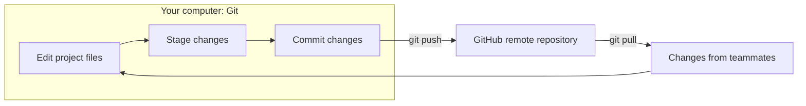
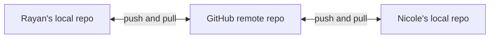
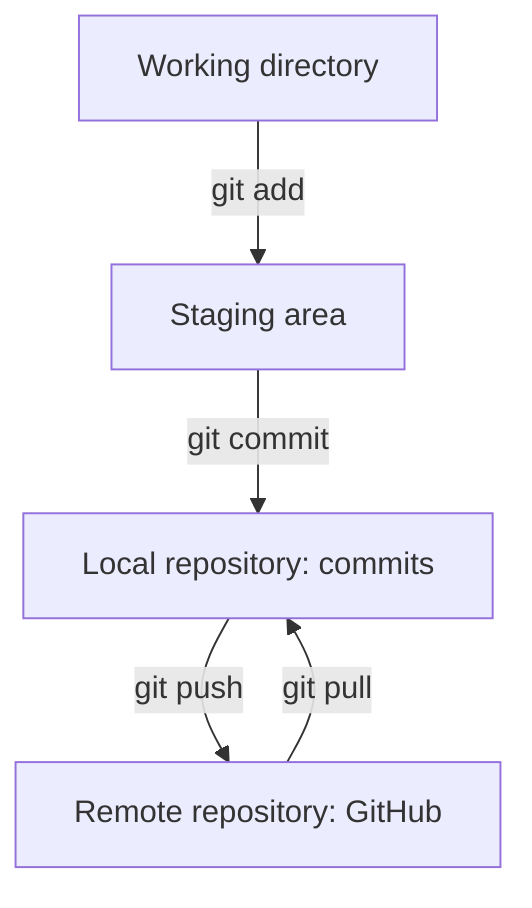
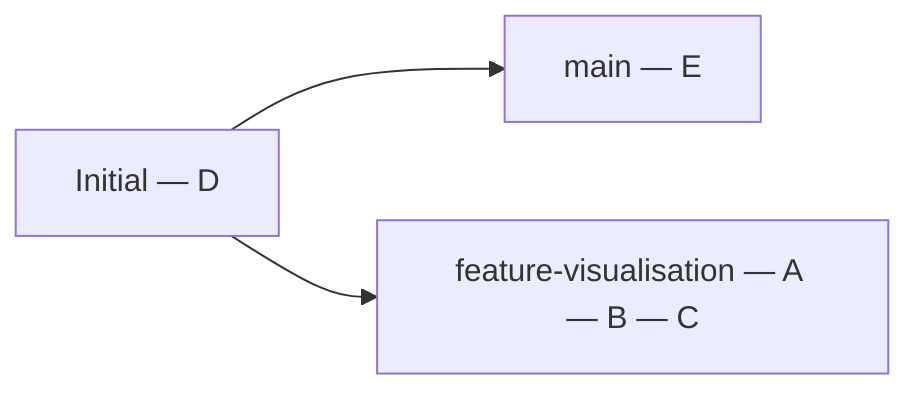
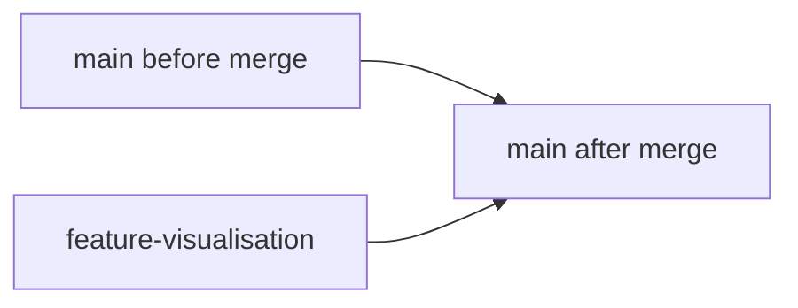
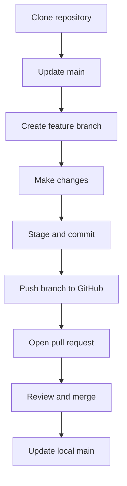
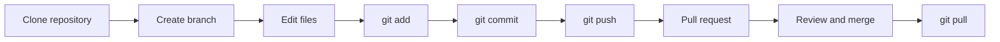

# Understanding Git & GitHub

**Author:** Manny Singh  
**Contact:** [inbox@manny-singh.com](mailto:inbox@manny-singh.com)

## Table of contents

- [1. Introduction: What Is Version Control and Why Does It Matter?](#1-introduction-what-is-version-control-and-why-does-it-matter)
- [2. Git vs GitHub](#2-git-vs-github)
  - [2.1 What Is Git?](#21-what-is-git)
  - [2.2 What Is GitHub?](#22-what-is-github)
  - [2.3 How Git and GitHub Work Together](#23-how-git-and-github-work-together)
- [3. Understanding Git Repositories](#3-understanding-git-repositories)
  - [3.1 What Is a Repository?](#31-what-is-a-repository)
  - [3.2 Local vs Remote Repositories](#32-local-vs-remote-repositories)
  - [3.3 The Working Directory and Staging Area](#33-the-working-directory-and-staging-area)
  - [3.4 Commits and Version History](#34-commits-and-version-history)
- [4. Branching and Merging](#4-branching-and-merging)
  - [4.1 What Is a Branch?](#41-what-is-a-branch)
  - [4.2 The Main Branch](#42-the-main-branch)
  - [4.3 Creating and Switching Between Branches](#43-creating-and-switching-between-branches)
  - [4.4 Merging Changes](#44-merging-changes)
  - [4.5 Understanding Merge Conflicts](#45-understanding-merge-conflicts)
- [5. Getting Started with Git and GitHub](#5-getting-started-with-git-and-github)
  - [5.1 Creating a GitHub Account](#51-creating-a-github-account)
  - [5.2 Installing Git](#52-installing-git)
  - [5.3 Configuring Git](#53-configuring-git)
  - [5.4 Creating and Cloning Repositories](#54-creating-and-cloning-repositories)
- [6. Essential Git Commands](#6-essential-git-commands)
  - [6.1 git init — Initialising a Repository](#61-git-init--initialising-a-repository)
  - [6.2 git clone — Cloning a Repository](#62-git-clone--cloning-a-repository)
  - [6.3 git status — Checking Your Changes](#63-git-status--checking-your-changes)
  - [6.4 git add — Staging Changes](#64-git-add--staging-changes)
  - [6.5 git commit — Saving Changes](#65-git-commit--saving-changes)
  - [6.6 git push — Uploading Changes](#66-git-push--uploading-changes)
  - [6.7 git pull — Retrieving Changes](#67-git-pull--retrieving-changes)
  - [6.8 git branch and git switch — Managing Branches](#68-git-branch-and-git-switch--managing-branches)
  - [6.9 git log — Viewing Commit History](#69-git-log--viewing-commit-history)
- [7. Collaborating with GitHub](#7-collaborating-with-github)
  - [7.1 Working on a Shared Repository](#71-working-on-a-shared-repository)
  - [7.2 What Is a Pull Request?](#72-what-is-a-pull-request)
  - [7.3 Code Reviews and Approvals](#73-code-reviews-and-approvals)
  - [7.4 A Typical GitHub Collaboration Workflow](#74-a-typical-github-collaboration-workflow)
- [8. Best Practices and Common Mistakes](#8-best-practices-and-common-mistakes)
  - [8.1 Keeping Your Branch Up to Date](#81-keeping-your-branch-up-to-date)
  - [8.2 Using .gitignore](#82-using-gitignore)
  - [8.3 Avoiding Common Git Mistakes](#83-avoiding-common-git-mistakes)
  - [8.4 Protecting Sensitive Information](#84-protecting-sensitive-information)
- [9. Git & GitHub Quick Reference](#9-git--github-quick-reference)
  - [9.1 Essential Terminology](#91-essential-terminology)
  - [9.2 Git Command Cheat Sheet](#92-git-command-cheat-sheet)
  - [9.3 Visual Summary of the Git Workflow](#93-visual-summary-of-the-git-workflow)

## 1. Introduction: What Is Version Control and Why Does It Matter?

Imagine you're working on a Python project. You write some code, make some improvements, and everything works fine. The next day, you change something and suddenly your program stops working.

You can't remember exactly what you changed, and you wish you could go back to yesterday's working version.

One solution might be to save multiple copies of your project:

```text
project/
├── analysis.py
├── analysis_v2.py
├── analysis_final.py
├── analysis_final_updated.py
└── analysis_final_ACTUAL_FINAL.py
```

This becomes confusing, particularly when several people are working on the same project.

Version control solves this problem.

Version control is a system that records changes to files over time, allowing you to track how a project develops and recover earlier versions when necessary.

With version control, you can:

- **Track changes:** See what changed, when it changed, and who changed it.
- **Restore previous versions:** Return to earlier versions if something goes wrong.
- **Collaborate:** Allow several people to work on the same project without constantly exchanging files.
- **Experiment safely:** Test new ideas without disrupting current code.
- **Understand project history:** See how a project has developed over time.

These tools are especially useful in software development and data science.

For example, imagine our group’s project. One person might be cleaning the dataset, another may be developing a model, and a third could build the visualisations.

Without version control, combining our work could become difficult. We might overwrite each other's changes or lose track of which code is most recent.

With version control, each person can work independently while contributing to the same project.

One of the most widely used version control systems is Git, which we'll talk about in this guide.

## 2. Git vs GitHub

Git and GitHub are related, but they are not the same thing.

### 2.1 What Is Git?

TLDR: Git is a software that runs on your computer and records changes to files within a project.

Git is a tool that tracks changes to your files, allowing you to manage different versions of a project, and collaborate with others. More formally, it’s called a distributed version control system.

Git allows you to:

- Track the history of a project.
- Save different versions of your work.
- Compare changes between versions.
- Create independent branches for new work.
- Combine changes made by different people.

“Distributed” is a fancy way of saying that each person working on a project can have their own copy of its files and version history.

Git does not require GitHub or an internet connection to work locally.

You can use Git entirely on your own computer.

### 2.2 What Is GitHub?

GitHub is an online platform for hosting Git repositories and collaborating on projects.

While Git handles version control, GitHub provides a place where repositories can be stored, shared, and managed online.

GitHub offers additional features, including:

- **Remote repositories:** Host projects online so others can access them.
- **Pull requests:** Propose changes and request feedback before merging them.
- **Code reviews:** Examine and discuss changes made by teammates.
- **Issues:** Track bugs, tasks, and ideas.
- **Access controls:** Manage who can view or modify a repository.

GitHub also allows you to browse code and its history directly through your web browser.

### 2.3 How Git and GitHub Work Together

Think of Git as the tool that manages your project's history, and GitHub as an online platform that allows you to share and collaborate on that project.

A typical workflow looks like this:



TLDR: You use Git to manage your work locally and GitHub to share that work with others.

## 3. Understanding Git Repositories

### 3.1 What Is a Repository?

A repository, often shortened to repo, is a project whose files and version history are managed by Git.

A repository can contain almost anything: Python scripts, documentation, datasets, or entire software applications.

For example:

```text
data-science-project/
├── README.md
├── data/
│   └── dataset.csv
├── src/
│   └── analysis.py
├── notebooks/
│   └── exploration.ipynb
└── requirements.txt
```

This structure looks like an ordinary directory.

However, when Git is initialised within it, Git creates a hidden `.git` directory containing the information needed to maintain the repository's history.

The `.git` directory stores Git's internal data and configuration. You generally shouldn't need to modify it manually.

### 3.2 Local vs Remote Repositories

There are two important places where a Git repository can exist.

**Local repository**

Is a repository stored on your own computer.

You can edit files, create commits, inspect history, and work on branches locally.

**Remote repository**

Is a repository stored elsewhere, such as on GitHub.

Remote repositories allow multiple people to share changes and collaborate.

For example:



Rayan and Nicole each have a local copy of the project.

When Rayan finishes making changes, he can upload his commits to GitHub.

Nicole can then retrieve those commits and incorporate them into her local copy.

The terms push and pull describe two ways of synchronising changes:

- **push:** Send local commits to a remote repository.
- **pull:** Retrieve and integrate changes from a remote repository.

### 3.3 The Working Directory and Staging Area

Before Git saves a new version of your project, changes typically pass through three areas.

1. **Working directory (working tree).** This contains the project files you're currently viewing and editing. When you modify a Python script or create a new file, those changes appear in your working directory.

2. **Staging area.** The staging area holds the changes you've selected for inclusion in your next commit. You might modify five files but only want to save changes to three of them in a particular commit. Git allows you to choose what gets staged.

3. **Local repository.** This is where Git stores committed versions of your project. Once you create a commit, Git records a snapshot of the staged content in the repository's history.

The process looks like this:



An important difference is that saving a file and committing a file are different actions.

Saving changes a file on your computer. Committing records a selected snapshot of your project in Git's history.

### 3.4 Commits and Version History

A commit is a recorded snapshot of your project at a particular point in its development.

Each commit includes information such as:

- A unique identifier (commit hash).
- The changes recorded in that commit.
- The author.
- The date and time.
- A message describing the change.

For example, a project's history might look like this:

```text
a3f821c  Add data visualisation
b7d40e2  Clean missing values
c91a05f  Import initial dataset
f4e287b  Initial commit
```

The most recent commit appears at the top in this example.

Git maintains the relationships between commits, allowing you to look at earlier versions and understand how the project evolved.

A commit is not necessarily a complete replacement copy of every file. Conceptually, however, it is helpful to think of commits as screenshots of the project's state.

## 4. Branching and Merging

One of Git's most important features is the ability to create branches.

Branches make it possible to develop new features, fix bugs, or experiment with changes independently.

### 4.1 What Is a Branch?

A branch is an independent line of development within a Git repository.

Imagine you're developing a program that analyses a dataset.

The existing code works correctly, but you want to experiment with adding a visualisation feature.

Rather than immediately changing the `main` version of the project, you create a new branch.

You can develop your feature on that branch without changing the `main` branch.

Conceptually:



The branch starts from an existing commit and develops its own history.

If the experiment works, you can merge your changes back into the `main` branch.

If it doesn't, you can abandon the branch without merging the experimental changes.

### 4.2 The Main Branch

When a new GitHub repository is created, its default branch is commonly named `main`.

This is generally treated as the primary version of the project.

For a collaborative project, the `main` branch often contains code that has been reviewed and accepted by the team.

Other branches might have names such as:

```text
main
feature/data-cleaning
feature/visualisation
fix/missing-values
```

These names describe the purpose of each branch.

There is nothing technically special about the name `main`: it's a convention, and repositories can use other default branch names.

### 4.3 Creating and Switching Between Branches

You can create a branch with:

```bash
git branch feature-visualisation
```

This creates a branch but does not switch to it.

To switch:

```bash
git switch feature-visualisation
```

Alternatively, you can create a branch and switch to it in one command:

```bash
git switch -c feature-visualisation
```

Once you're on that branch, any new commits you make will belong to that branch.

**To return to the `main` branch:**

```bash
git switch main
```

You can display your local branches using:

```bash
git branch
```

Git will indicate which branch you're currently on.

### 4.4 Merging Changes

Merging is the process of combining changes from different branches.

Suppose you've finished developing your visualisation feature.



You now want to incorporate those changes into `main`.

One approach is:

```bash
git switch main
git merge feature-visualisation
```

This merges the feature branch into your currently checked-out `main` branch.

Depending on the relationship between the branches, Git may perform a fast-forward merge or create a merge commit.

TLDR: The important idea is that Git can integrate the development history from both branches.

In collaborative projects hosted on GitHub, merging is frequently performed through a pull request.

### 4.5 Understanding Merge Conflicts

Sometimes Git cannot automatically combine changes from two branches.

This is called a merge conflict.

For example, imagine Em and Angela both modify the same line of code.

Em changes:

```python
learning_rate = 0.01
```

Angela changes the same line to:

```python
learning_rate = 0.1
```

When their changes are merged, Git may not know which version to keep.

Git then marks the conflicting content within the file.

For example:

```text
<<<<<<< HEAD
learning_rate = 0.01
=======
learning_rate = 0.1
>>>>>>> feature-model
```

These markers identify the competing changes.

To resolve the conflict, someone must decide what the final code should contain, edit the file accordingly, and remove the conflict markers.

The resolved file can then be staged and the merge completed.

Merge conflicts are normal. They do not always mean something has gone wrong.

## 5. Getting Started with Git and GitHub

### 5.1 Creating a GitHub Account

To use GitHub, visit [github.com](https://github.com) and create an account.

Once signed in, you can:

- Create repositories.
- Explore public projects.
- View other people's code.
- Collaborate on projects.
- Manage your own technical portfolio.

Every GitHub account has a unique username.

Your public profile is typically accessible at:

`https://github.com/YOUR-USERNAME`

You can also create a repository through GitHub's website without installing Git locally.

However, understanding the command-line is particularly valuable for software development and data science.

### 5.2 Installing Git

Git is available for Windows, macOS, and Linux.

You can find installation instructions for your operating system at:

[Official Git installation website](https://git-scm.com/install/)

**Windows**

Download and install Git for Windows. This provides Git along with Git Bash, a terminal environment where you can run Git commands.

**macOS**

Open Terminal and enter:

```bash
git --version
```

If Git is available, you'll see its installed version.

If it isn't installed, macOS may prompt you to install the Command Line Tools.

Alternatively, users with Homebrew can install Git using:

```bash
brew install git
```

#### Linux (Ubuntu/Debian)

On Ubuntu or Debian, install Git with:

```bash
sudo apt update
sudo apt install git
```

### 5.3 Configuring Git

Before creating commits, configure your name and email address.

These details identify you as the author of commits.

```bash
git config --global user.name "Your Name"
git config --global user.email "you@example.com"
```

The `--global` option applies these settings to repositories for your user account on that computer, unless overridden by repository-specific configuration.

You can inspect your configuration using:

```bash
git config --global --list
```

If you want your commits associated with your GitHub profile, use an email address recognised by your GitHub account.

**Authentication**

When communicating with GitHub, Git may need to authenticate you.

Two common authentication methods are:

- **HTTPS:** Connect using an HTTPS repository URL and authenticate through a supported credential manager, GitHub CLI, or personal access token.
- **SSH:** Authenticate using a cryptographic key pair associated with your GitHub account.

GitHub account passwords cannot be used directly for Git operations over HTTPS.

For beginners, HTTPS with a supported credential manager is generally a convenient starting point.

See [GitHub's authentication documentation](https://docs.github.com/en/authentication/keeping-your-account-and-data-secure/about-authentication-to-github) for setup guidance.

### 5.4 Creating and Cloning Repositories

There are two common ways to start working with Git.

**Creating a new repository on GitHub**

On GitHub:

- Select the option to create a new repository.
- Choose a repository name.
- Select whether it should be public or private.
- Optionally initialise it with a README.
- Create the repository.

You now have a remote repository hosted on GitHub.

**Cloning an existing repository**

Cloning downloads the project files and Git history to your computer, and sets up a connection to the original remote repository (typically named `origin`). It is a common way to begin working on an existing GitHub project. The command syntax is covered in [Section 6.2](#62-git-clone--cloning-a-repository).

## 6. Essential Git Commands

Git has a lot of commands, but you only need a few for everyday development.

The following are the most useful.

### 6.1 git init — Initialising a Repository

Initialises a new Git repository within a directory.

```bash
git init
```

Git creates a hidden `.git` directory to store the repository's metadata and version history.

Use `git init` when you have a local project that is not yet tracked by Git.

You do not normally need to run it after cloning an existing repository, because a clone already includes the Git repository.

### 6.2 git clone — Cloning a Repository

Creates a local copy of an existing repository.

```bash
git clone https://github.com/USERNAME/REPOSITORY.git
```

This downloads the project files and repository history.

Cloning is generally how you begin working on a project that already exists on GitHub.

### 6.3 git status — Checking Your Changes

Displays the current state of your working directory and staging area.

```bash
git status
```

It shows information such as:

- Your current branch.
- Files that have been modified.
- New files not yet tracked by Git.
- Changes staged for the next commit.
- Whether your branch is ahead of or behind its configured remote branch.

When you're unsure what Git is doing, `git status` is a good place to start.

### 6.4 git add — Staging Changes

Adds changes to the staging area.

**To stage one file:**

```bash
git add analysis.py
```

**To stage all changes beneath the current directory:**

```bash
git add .
```

Staging does not create a commit.

It simply selects the content that should be included in the next commit.

If you edit a file again after staging it, you generally need to stage the new changes again to include them in that commit.

### 6.5 git commit — Saving Changes

Creates a new commit containing the staged changes.

```bash
git commit -m "Add initial data analysis"
```

The `-m` flag allows you to provide a commit message directly.

A commit records the staged snapshot in your local repository.

It does not automatically upload your work to GitHub.

For that, you need `git push`.

### 6.6 git push — Uploading Changes

Uploads local commits to a remote repository.

```bash
git push
```

If your current branch has a configured upstream branch, Git knows where to send the commits.

When publishing a new branch for the first time, you may need:

```bash
git push -u origin feature-visualisation
```

Here:

- `origin` is the name of the remote repository.
- `feature-visualisation` is the branch being pushed.
- -u configures the upstream tracking relationship.

After this, subsequent pushes from the same branch can usually use `git push`.

### 6.7 git pull — Retrieving Changes

Retrieves changes from a remote repository and integrates them into your current branch.

```bash
git pull
```

This is useful when teammates have committed changes to GitHub that you don't yet have locally.

Conceptually, `git pull` combines two operations:

```bash
git fetch + integration
```

Fetching retrieves remote commits, while the integration step incorporates them into your current branch.

A typical use is updating your local `main` branch:

```bash
git switch main
git pull
```

It's good practice to check for uncommitted changes before pulling, as incoming changes may conflict with your local work.

### 6.8 git branch and git switch — Managing Branches

**To list local branches:**

```bash
git branch
```

**To create a branch:**

```bash
git branch feature-analysis
```

**To switch to that branch:**

```bash
git switch feature-analysis
```

**To create and switch in one command:**

```bash
git switch -c feature-analysis
```

**To return to the `main` branch:**

```bash
git switch main
```

Branches help organise work and prevent unfinished changes from immediately affecting the `main` version of a project.

### 6.9 git log — Viewing Commit History

Displays the history of commits.

```bash
git log
```

This shows details such as commit hashes, authors, dates, and messages.

**For a more compact view:**

```bash
git log --oneline
```

An example output might look like:

a3f821c Add visualisation module

b7d40e2 Clean missing data

c91a05f Initial data import

This is particularly useful when trying to understand how a project has changed over time.

## 7. Collaborating with GitHub

GitHub provides a collaborative environment built around repositories, branches, commits, and pull requests.

### 7.1 Working on a Shared Repository

Imagine a team of three developing a data science project.

They divide the work as follows:

- **Rayan:** Data cleaning.
- **Nicole:** Exploratory data analysis.
- **Em:** Data visualisation.

All three need access to the same project.

Rather than editing the `main` branch simultaneously, each team member can work on a separate branch.

For example:

```text
data-science-project
│
├── main
│
├── feature/data-cleaning
│
├── feature/exploratory-analysis
│
└── feature/visualisation
```

This allows each person to develop their contribution independently.

Once their work is ready, they can propose incorporating it into `main`.

Team members with the appropriate permissions can push their branches to the shared GitHub repository.

### 7.2 What Is a Pull Request?

A pull request,, is a proposal to merge changes from one branch into another.

Pull requests are a GitHub feature rather than a Git command.

Suppose Angela has finished cleaning the dataset on her branch.

She opens a pull request proposing that her changes be merged into `main`.

The pull request provides a place to:

- View the proposed changes.
- Compare the source and target branches.
- Discuss implementation decisions.
- Request reviews.
- Run automated checks, if configured.
- Approve and merge the contribution.

The term pull request can initially seem confusing.

Essentially, Angela is asking the project maintainers to review and incorporate the changes from her branch.

Opening a pull request does not automatically merge the changes.

### 7.3 Code Reviews and Approvals

A code review is the process of examining another person's proposed changes before they are merged.

On GitHub, reviewers can inspect the differences between branches and leave comments on particular lines.

They might identify:

- Bugs or incorrect logic.
- Opportunities to simplify code.
- Inconsistencies with the rest of the project.
- Missing documentation.
- Potential improvements in performance or readability.

Reviews also provide an opportunity for teammates to learn from one another.

Depending on the repository's configuration, reviewers may approve a pull request, request changes, or leave comments without making a formal approval decision.

Some repositories require approval before changes can be merged into protected branches.

Code reviews help teams maintain a shared understanding of the project, rather than having everyone work in isolation.

### 7.4 A Typical GitHub Collaboration Workflow

The following is a common workflow when contributing to a shared repository where you have write access.

#### Step 1 — Clone the repository

Download the existing project:

```bash
git clone https://github.com/USERNAME/PROJECT.git
cd PROJECT
```

#### Step 2 — Update the main branch

Make sure your local `main` branch contains the latest remote changes:

```bash
git switch main
git pull
```

#### Step 3 — Create a feature branch

```bash
git switch -c feature/data-cleaning
```

You now have an independent branch for your contribution.

#### Step 4 — Make changes

Edit the necessary files in your preferred editor.

For example, you might modify `clean_data.py`.

#### Step 5 — Stage and commit

```bash
git add clean_data.py
git commit -m "Implement missing value handling"
```

Your changes are now recorded locally on your feature branch.

#### Step 6 — Push your branch

```bash
git push -u origin feature/data-cleaning
```

Your branch is now available on GitHub.

#### Step 7 — Open a pull request

On GitHub, navigate to the repository and open a pull request from:

`feature/data-cleaning` → `main`

Describe the changes and request a review if appropriate.

#### Step 8 — Review and merge

Teammates can review your pull request and suggest improvements.

Once the changes are ready and repository requirements are satisfied, the pull request can be merged.

Your contribution is now incorporated into the `main` branch.

#### Step 9 — Synchronise your local repository

After the pull request has been merged, return to your local `main` branch and update it:

```bash
git switch main
git pull
```

You now have the latest version of the project.

The overall workflow is:



This approach allows team members to contribute independently while keeping the shared project organised.

## 8. Best Practices and Common Mistakes

### 8.1 Keeping Your Branch Up to Date

When several people work on the same repository, the `main` branch can change frequently.

Your feature branch may have been created before your teammates merged their latest changes.

As a result, your branch can become outdated compared with `main`.

To retrieve the latest `main` branch updates:

```bash
git switch main
git pull
```

If your feature branch needs those changes, you can integrate the updated `main` branch into it:

```bash
git switch feature/data-cleaning
git merge main
```

If the changes conflict, Git will ask you to resolve the conflicts.

It's generally easier to integrate changes regularly rather than allowing a long-running feature branch to become significantly outdated.

Before starting new work, make sure you're on the intended branch and understand whether your local repository is up to date.

### 8.2 Using .gitignore

Not every file in your project should be tracked by Git.

Some files are generated automatically, contain local configuration, or should never be shared.

A `.gitignore` file tells Git which untracked files and directories it should ignore.

For example, a Python project might contain:

```gitignore
# Python cache files
__pycache__/
*.pyc
# Virtual environments
.venv/
# Local environment variables
.env
# Jupyter notebook checkpoints
.ipynb_checkpoints/
# Operating system files
.DS_Store
```

This helps keep repositories organised and prevents unnecessary local files from being added.

However, `.gitignore` does not automatically remove files that Git is already tracking.

If a file has already been committed, additional steps are required to stop tracking it.

### 8.3 Avoiding Common Git Mistakes

Mistake 1: Working on the wrong branch

You intend to make a change on a feature branch but accidentally make it on `main`.

Before making changes, check your branch:

```bash
git status
```

Mistake 2: Forgetting to commit

You edit and save files locally, but never create a commit.

Remember that saving files does not automatically record a Git snapshot.

Check which changes remain uncommitted:

```bash
git status
```

Mistake 3: Forgetting to push

You've successfully committed your changes, but they aren't visible on GitHub.

This happens because commits are initially stored locally.

Use:

```bash
git push
```

Mistake 4: Pushing before checking staged changes

Using `git add .` can stage more files than intended.

Before committing, review your staged changes:

```bash
git diff --staged
```

This displays the changes that will be included in your next commit.

Mistake 5: Ignoring merge conflicts

When Git reports a merge conflict, it must be resolved before the affected merge can be completed.

Don't just delete the conflict markers without examining the competing changes.

Check with your teammates when you're unsure which version should be retained.

### 8.4 Protecting Sensitive Information

Git repositories can contain much more than source code.

It's important to avoid accidentally publishing sensitive information, particularly in public repositories.

Examples include:

- API keys and access tokens.
- Passwords.
- Private SSH keys.
- Database credentials.
- Confidential or personally identifiable data.
- Private datasets that you don't have permission to share.

Remember that committing sensitive information can preserve it in the repository's history, even if you delete it from the latest version later.

Using `.gitignore` can help prevent certain files from being tracked, but it is not a substitute for proper credential management.

Use environment variables or an appropriate secrets management system for credentials.

If a secret is accidentally committed, treat it as compromised and revoke or rotate it promptly. Removing the file alone is not sufficient.

## 9. Git & GitHub Quick Reference

### 9.1 Essential Terminology

| Term | Meaning |
| --- | --- |
| Version control | Tracking changes to files over time |
| Git | Distributed version control software |
| GitHub | Online Git repository hosting and collaboration platform |
| Repository | Project files and their Git version history |
| Local repository | Repository stored on your computer |
| Remote repository | Repository stored elsewhere, such as GitHub |
| Clone | Create a local copy of an existing repository |
| Commit | Recorded snapshot of staged project content |
| Branch | Independent line of development |
| Main branch | Commonly the primary branch of a project |
| Merge | Combine changes from different branches |
| Merge conflict | Changes Git cannot automatically reconcile |
| Staging area | Changes selected for the next commit |
| Push | Upload local commits to a remote repository |
| Pull | Retrieve and integrate remote changes |
| Pull request | Proposal to merge changes between branches |
| Fork | Separate copy of a repository under another account |
| Origin | Conventional name for a remote repository |

### 9.2 Git Command Cheat Sheet

| Command | Purpose |
| --- | --- |
| `git init` | Initialise a repository |
| `git clone <url>` | Clone an existing repository |
| `git status` | Check repository status |
| `git add <file>` | Stage a specific file |
| `git add .` | Stage changes beneath the current directory |
| `git commit -m "message"` | Create a commit |
| `git push` | Push commits to a remote |
| `git pull` | Retrieve and integrate remote changes |
| `git branch` | List local branches |
| `git switch <branch>` | Switch branches |
| `git switch -c <branch>` | Create and switch to a new branch |
| `git merge <branch>` | Merge a branch into the current branch |
| `git log` | View commit history |
| `git log --oneline` | View compact commit history |
| `git diff` | View unstaged changes |
| `git diff --staged` | View staged changes |
| `git remote -v` | View configured remotes |

### 9.3 Visual Summary of the Git Workflow

The following diagram brings together the `main` concepts covered in this guide.



TLDR: Git records and manages changes. GitHub is a platform where you can share, review and combine those changes with other people.
